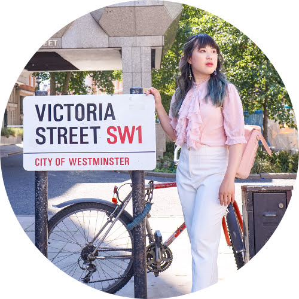

{: width="20%" }

Professionally, I work as a **software engineer**, but I'm also an author, (aspiring) artist and photographer, eager traveler, occasional content creator, fashion enthusiast, tech volunteer, fangirl, ... (the list goes on).

Passionate, self-driven, and interested in a crazy amount of things (people around me can confirm that!), I aspire to be a Renaissance Woman (a.k.a. polymath).

## Updates
* 2026: I'm presenting in the [Android Dev Summit](https://developer.android.com/events/dev-summit)! Tune in to our talk: Unlock agentic capabilities in your app with ML Kit Gen AI.
* 2026: I'm performing in my first ever City Academy musical theatre panto show (as part of the ensemble), [Puss in Boots](https://www.eventbrite.co.uk/e/the-city-academy-musical-theatre-companies-puss-in-boots-tickets-1999529140485)! 
